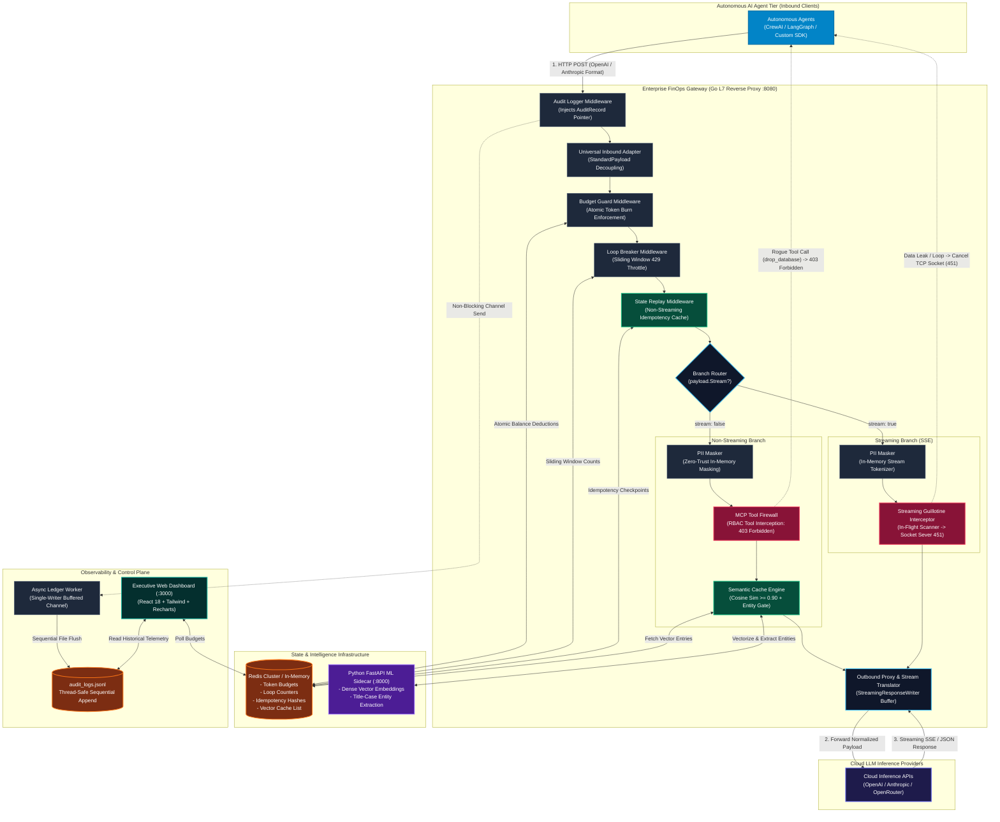

# Enterprise AI FinOps Gateway — Production Architecture

This document outlines the verified, production architecture of the **Enterprise AI FinOps Gateway**, correcting the topology, security boundaries, and pipeline flow.

---

## 1. Architectural Audit: Flaws in the Legacy / Initial Diagram

An initial high-level diagram suggested:
`Autonomous Agents -> Go L7 Gateway -> [Redis, FastAPI Sidecar, Cloud LLM] -> Go Proxy -> Client`

This representation had 5 fundamental architectural inaccuracies:
1. **Separated Gateway vs. Proxy:** Autonomous Agents **are** the clients. The Go L7 Gateway is an integrated Layer 7 reverse proxy whose middleware pipeline wraps the outbound proxy handler. There are not two separate gateways.
2. **Zero-Trust Violation (PII):** Redis does **NOT** store PII maps. In [`internal/middleware/pii_masker.go`](../internal/middleware/pii_masker.go), PII tokenization and unmasking are strictly **in-memory within the Go request context (`r.Context()`)**. Persisting PII to Redis would violate GDPR/HIPAA.
3. **Misplaced Semantic Cache:** The Python FastAPI sidecar does **not** perform semantic caching; it is a stateless helper generating vector embeddings and extracting normalized entities. The actual **Semantic Cache engine** (vector search, cosine similarity $\ge 0.90$, entity matching, and Redis caching) runs inside the Go Gateway middleware for microsecond latency.
4. **Omission of Core Security Controls:** The diagram lacked the **MCP Tool-Level Firewall** (intercepting unauthorized tool executions like `drop_database` with `403 Forbidden`) and the **Streaming Guillotine** (in-flight SSE scanner severing TCP sockets on data leaks with `451`).
5. **Missing Observability & Control Plane:** Lacked the **single-writer thread-safe asynchronous ledger worker** (`audit_logs.jsonl`) and the **Executive React Web Dashboard** running on port 3000.

---

## 2. Corrected Production Component Architecture

---

## 3. Technology Stack Reference

| Component | Technology | Role |
|---|---|---|
| **L7 Core Proxy** | Go 1.23+ (`net/http`) | Universal decoupled schema translation and high-concurrency middleware pipeline. |
| **State & Policy Store** | Redis v9 / Miniredis | Distributed token quota tracking, loop breaker sliding window counters, idempotency cache, and vector entry storage. |
| **Zero-Trust Privacy** | Go Context (`r.Context()`) | In-memory tokenization and unmasking of PII (SSNs, emails); zero persistence to disk or Redis. |
| **Semantic Intelligence** | Python FastAPI (`ml-sidecar`) | Dense text embeddings, cosine distance normalization, and entity extraction. |
| **Agent Tool Governance** | MCP Firewall & JSON RBAC | Intercepts rogue model tool execution payloads (`drop_database`) before reaching agent runtime. |
| **Streaming Protection** | Streaming Guillotine (`http.Flusher`) | In-flight SSE character scanning; severs upstream TCP sockets on hallucination loops or data leaks. |
| **Audit Persistence** | Async Single-Writer Ledger | Thread-safe Go channel-based sequential logging to `audit_logs.jsonl` with zero HTTP latency penalty. |
| **Executive Control Plane** | React 18 + Tailwind CSS + Recharts | Real-time browser dashboard on port `3000` with live KPI cards, quota warning alerts, and perimeter telemetry log. |
